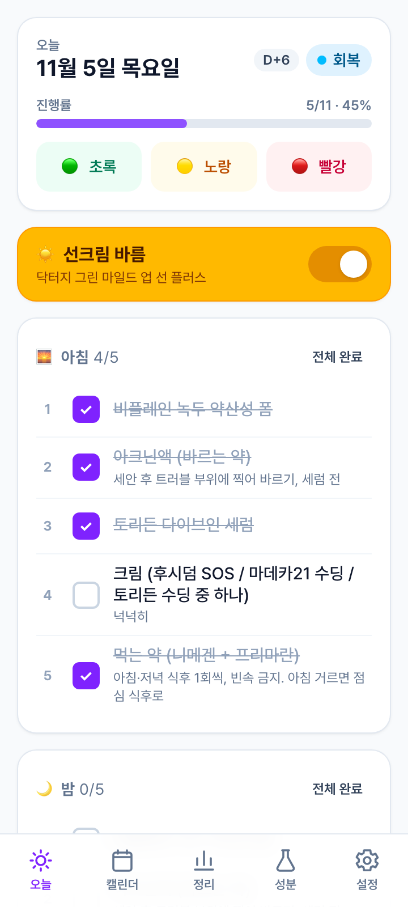
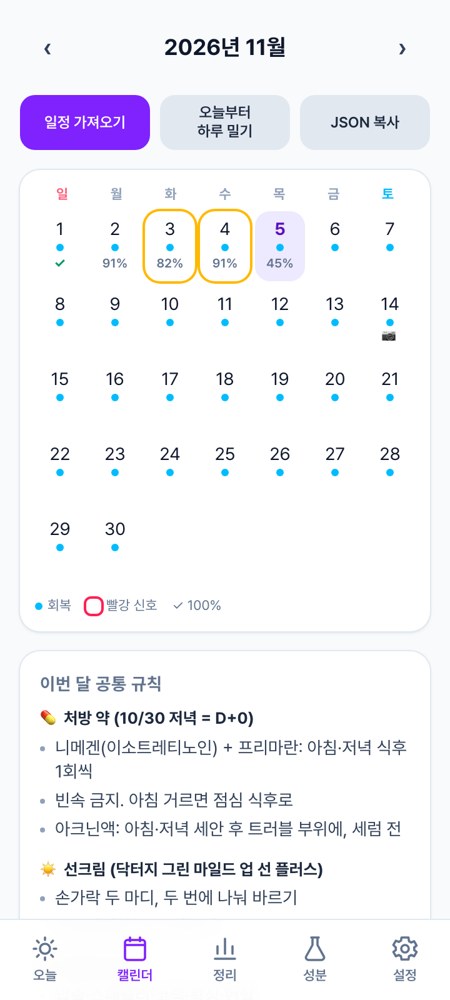
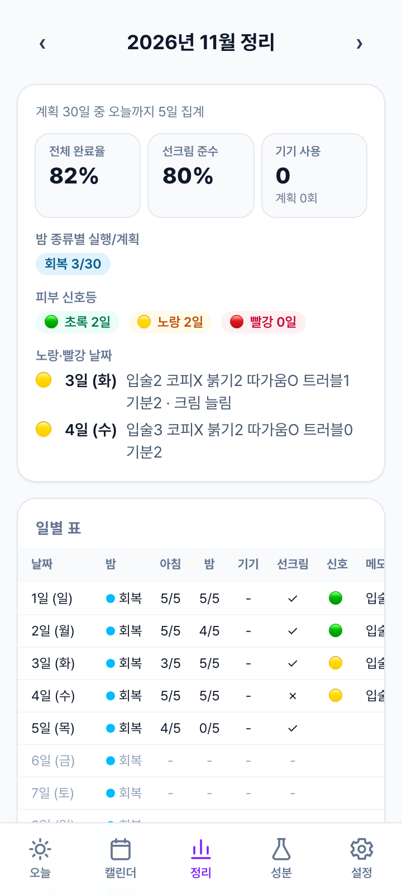
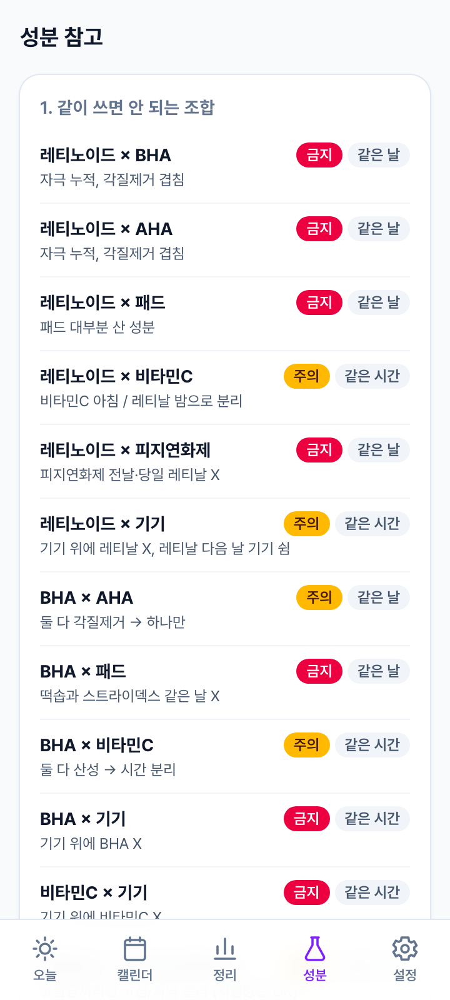
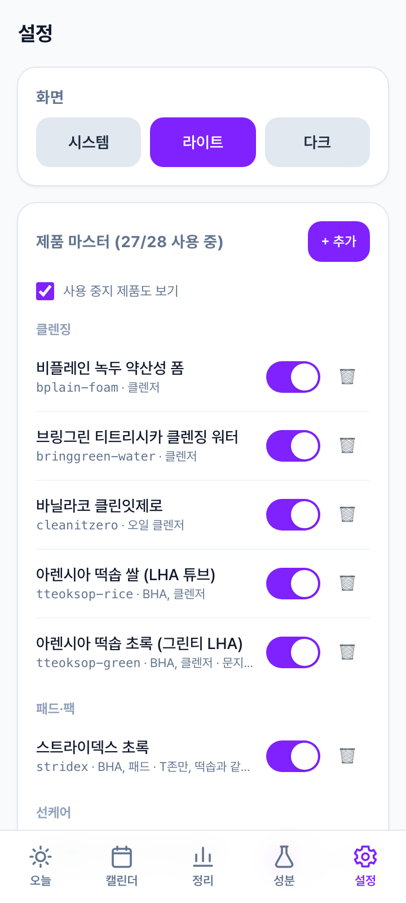

# 루틴 — 스킨케어 루틴 트래커 PWA

혼자 쓰는 스킨케어 루틴 관리 앱. 서버·로그인·DB 없음, 모든 데이터는 폰 브라우저의 localStorage에만 저장돼요.
안드로이드 Chrome에서 "홈 화면에 추가"로 설치하면 오프라인에서도 앱처럼 동작합니다.

| 오늘 | 캘린더 | 정리 | 성분 | 설정 |
| --- | --- | --- | --- | --- |
|  |  |  |  |  |

## 기술 스택

Vite + React 18 + TypeScript · Tailwind CSS v4 · vite-plugin-pwa · zod · date-fns(ko) · jsPDF + html2canvas · react-router-dom(hash) · vitest · Playwright(스크린샷)

## 개발

```bash
npm install
npm run dev          # http://localhost:5173
npm test             # vitest (규칙 엔진 · 하루 밀기 · 완료율 · JSON 검증 · 저장소 · 시드 일정)
npm run build        # tsc + vite build → dist/
npm run preview      # 빌드 결과 미리보기
npm run icons        # public/favicon.svg → public/icons/*.png (sharp)
npm run screenshots  # 360×800 탭별 스크린샷 5장 → screenshots/ (먼저 build, 처음 한 번 `npx playwright install chromium`)
```

## 폰에 설치하기 (홈 화면에 추가)

1. 아래 "GitHub Pages 배포"로 올린 주소를 안드로이드 Chrome에서 연다.
2. 오른쪽 위 ⋮ 메뉴 → **홈 화면에 추가** (또는 주소창의 "설치" 아이콘) → 이름 "루틴" 확인 → 추가.
3. 홈 화면의 루틴 아이콘으로 실행. 한 번 열고 나면 비행기 모드에서도 모든 탭이 동작해요.
4. 업데이트는 자동: 새 버전을 배포하면 다음 실행 때 서비스워커가 교체돼요.

> 데이터는 그 브라우저(Chrome) 프로필의 localStorage에만 있어요. 앱 데이터 삭제나 브라우저 초기화를 하면 사라지니, 정리 탭에서 **JSON 백업**을 가끔 받아 두세요.

## 매달 일정 JSON 붙여넣기

- **캘린더 → 일정 가져오기** 버튼 → textarea에 `MonthSchedule` JSON 붙여넣기 → **검증 후 가져오기**.
- 같은 달이 이미 있으면 일정만 교체되고 **체크 기록은 보존**돼요.
- 검증에 실패하면 어떤 필드가 틀렸는지 한국어로 표시해요 (예: `days[3].nightType: 허용되지 않는 값. 가능한 값 → "레티날", "미백", …`).
- 일정에 쓴 제품 id가 제품 마스터에 없으면 **경고만** 띄우고 가져오기는 진행돼요 (설정 탭에서 제품을 추가하면 이름이 표시돼요).
- 오늘 화면의 일정이 없으면 "이번 달 일정 가져오기" 버튼이 바로 보여요.
- **캘린더 → JSON 복사**로 현재 달 일정을 클립보드에 복사해 Claude에게 붙여넣고, 다음 달 일정을 같은 형식으로 받아오면 돼요.

### MonthSchedule 형식 (절대 바꾸지 말 것)

```jsonc
{
  "schemaVersion": 1,
  "month": "2026-12",
  "globalNotes": ["이번 달 공통 규칙"],          // 선택
  "days": [
    {
      "date": "2026-12-01",                        // YYYY-MM-DD, month 안의 날짜, 중복 X
      "nightType": "미백",                         // 레티날 | 미백 | 모공 | 휴식 | 연화제 | 회복
      "morning": ["bplain-foam", "b3zinc", "anua-pdrn", "torriden-cream", "madeca21-soothing", "dermablock-daily"],
      "night": ["bplain-foam", "torriden-serum", "txa6", "madeca21-soothing"],
      "device": "밤",                              // 아침 | 밤 | 쉼
      "notes": ["그날 특이사항"],                  // 선택
      "checkpoint": false                          // 선택, 사진 체크포인트 날
    }
  ]
}
```

`notes`/`globalNotes`는 문자열 배열이지만 앱이 마크다운처럼 보여줘요: `"### 제목"`은 섹션 제목, `"- 내용"`(또는 그냥 문장)은 불릿. 날짜 notes의 `"D+3"` 같은 줄은 헤더 칩으로 빠져요.

제품 id 목록은 **설정 → 제품 마스터**(각 항목 아래 회색 모노스페이스) 또는 `src/data/products.ts`에서 확인. 내장 id:
`bplain-foam` `bringgreen-water` `cleanitzero` `tteoksop-rice` `tteoksop-green` `stridex` `dermablock-daily` `vt-sun` `zeroid` `torriden-cream` `madeca21-soothing` `madeca21-toning` `txa6` `exo-retinal` `patheon-spot` `b3zinc` `torriden-serum` `anua-pdrn` `niacin20` `vitc15` `fucidum-mist` `booster-pro` `ilso-softener` `numbuzin-blur` `rx-meds` `acnin` `drg-sun` `cream-rx`

Claude에게 부탁할 때 예시:
> 아래는 내 11월 일정 JSON이야. 같은 schemaVersion/필드 형식으로 12월(2026-12) 일정을 만들어 줘. 밤 패턴은 월·목 레티날 / 수·토 모공 / 화·금·일 미백, 레티날 다음 날은 device "쉼" … (JSON 붙여넣기)

### 오늘부터 하루 밀기

일정을 못 지킨 날 캘린더에서 **오늘부터 하루 밀기**를 누르면 오늘 이후 남은 계획이 하루씩 뒤로 밀려요. 오늘은 휴식(아침 루틴 + 선크림만)이 되고, 이 달 마지막 날 계획은 잘려 나가요. 되돌리기가 없으니 먼저 JSON 복사를 권해요.

## 백업 / 복원 (기기 바꿀 때)

1. **정리 → JSON 백업**: 일정 + 체크 기록 + 제품 마스터 + 설정을 한 파일(`routine-backup-날짜.json`)로 저장.
2. 새 폰에서 앱을 열고 **정리 → JSON 백업 복원** → 파일 선택(또는 내용 붙여넣기) → 검증 후 복원. 현재 데이터는 전부 덮어써져요.
3. 그 외 내보내기: **PDF**(A4 세로, 월간 정리표, 한글 폰트 깨짐 없음) · **CSV**(엑셀용 UTF-8 BOM).

## GitHub Pages 배포

```bash
# 1) 저장소 만들기 (무료 계정은 public 이어야 Pages 가능)
git init && git add -A && git commit -m "루틴 앱"
gh repo create routine --public --source=. --push

# 2) 배포 (BASE_PATH=/routine/ 로 빌드 → gh-pages 브랜치에 push)
npm run deploy
```

- 저장소 이름이 `routine`이 아니면 `package.json`의 `predeploy` 스크립트에서 `BASE_PATH=/저장소이름/`을 바꾸세요. (hash 라우터라 경로는 그대로 동작하고, 에셋 경로만 base의 영향을 받아요.)
- GitHub → Settings → Pages → Source가 `gh-pages` 브랜치인지 확인. 주소: `https://<깃헙아이디>.github.io/routine/`
- 사용자 페이지(`<아이디>.github.io` 저장소)에 올린다면 `BASE_PATH=/`로 빌드하면 돼요.

## (선택) Capacitor로 Android APK 만들기

Android Studio가 설치돼 있어야 해요.

```bash
npm i -D @capacitor/core @capacitor/cli @capacitor/android
npx cap init 루틴 com.example.routine --web-dir dist
npm run build                  # BASE_PATH 없이(= "/") 빌드
npx cap add android
npx cap sync
npx cap open android           # Android Studio → Build → Build Bundle(s)/APK(s) → Build APK(s)
```

앱 안의 WebView도 localStorage를 쓰므로 데이터 구조는 PWA와 같아요. PWA와 APK 사이 이동은 JSON 백업/복원으로.

## 폴더 구조

```
src/
  schema/index.ts        zod 스키마 + 타입 (Product, MonthSchedule, DayLog, ConflictRule, 저장 컨테이너, Backup)
  data/products.ts       내장 제품 마스터 28개
  data/rules.ts          성분 충돌 규칙 13개 + 고함량 한정 규칙 목록
  data/schedule.2026-10.json   시드 일정: 처방 시작 이틀 (scripts/gen-schedule.mjs 로 생성)
  data/schedule.2026-11.json   시드 일정: 11월 처방 루틴
  store/storage.ts       localStorage 슬라이스 (zod 검증, 마이그레이션 훅, 저장 실패 이벤트)
  store/index.ts         슬라이스 4개(제품/일정/기록/설정) + 액션 + 백업/복원/전체 삭제
  lib/rules.ts           규칙 엔진 (충돌 찾기, 오늘 경고 카드 생성)
  lib/shift.ts           오늘부터 하루 밀기
  lib/progress.ts        완료율, 월간 정리 집계, 자주 빼먹은 제품
  lib/validate.ts        JSON 검증 + zod 이슈 → 한국어 메시지
  lib/export.ts          CSV / PDF / 클립보드 / 다운로드
  pages/                 Today · Calendar · Summary · Safety · Settings
  components/            DayView(오늘·캘린더 공용), ImportScheduleModal, Checklist, Modal, Toast …
  test/                  vitest 단위 테스트
scripts/                 gen-schedule.mjs · make-icons.mjs · screenshots.mjs
```

## 결정 사항 (스펙에 없어서 임의로 정한 것)

- **선크림 집계**: `sunscreen` 태그 제품은 아침 체크리스트에서 빼고, 상단 "선크림 바름" 토글 1개로 센다. 진행률 전체 = 아침(선크림 제외) + 밤 + 기기(쉼이 아닐 때 1) + 선크림 1.
- **완료율/준수율 분모**는 오늘 포함 과거의 계획된 날만. 미래 날짜는 표에서 회색 `-`.
- **nightType "실행"** = 그날 밤 항목을 전부 체크한 날(밤이 빈 휴식일은 지나면 실행으로 침).
- **하루 밀기**: 오늘 자리는 `휴식`(원래 오늘의 아침 목록 유지, 밤 없음, 기기 쉼)으로 채우고 이후 계획을 하루씩 뒤로. 월 마지막 날 계획은 잘림. 일정에 오늘이 없으면 오늘 이후 첫 날부터 적용.
- **나이아신아마이드 × 기기** 규칙은 태그만으로 B3징크(저함량)와 20%를 구분할 수 없어, `src/data/rules.ts`의 `HIGH_STRENGTH_ONLY` 목록에 넣고 두 제품 중 하나의 **이름 또는 note에 "20%"/"고함량"**이 있을 때만 적용. 성분 탭 표에 "(고함량만)"으로 표시.
- **기기**는 그날 `device` 슬롯(아침/밤)의 아이템으로 취급해 같은 시간 규칙과 대조. 어제 레티날인데 오늘 기기 슬롯이 있으면 주의, 내일 피지연화제이면 오늘 레티날 금지/기기 쉼 안내도 경고 카드에 함께 표시.
- **알 수 없는 제품 id**는 가져오기를 막지 않고 경고만. 화면에는 id 그대로 + "미등록" 칩.
- **시드 일정(2026-10 이틀 + 2026-11)**: 2026-10-30 피부과 처방(이소트레티노인) 시작으로 요일별 레티날/모공/미백 패턴은 전부 취소하고, 매일 같은 **처방 루틴**(nightType `회복`, 기기 `쉼`)으로 채웠어요. 생성 규칙은 `scripts/gen-schedule.mjs`.
  - 아침: 비플레인 → 아크닌액 → 토리든 세럼 → 크림 → 선크림(닥터지, 토글로 집계) → 먹는 약 / 밤: 비플레인 → 아크닌액 → 토리든 세럼 → 크림 → 먹는 약.
  - 앱에 없는 기능은 notes/globalNotes로 대신: D+N 카운터는 각 날짜 notes 첫 줄, 재진 날짜 확정(11/5)·올영 세일·약 소진 예정(11/9) 같은 할 일도 그날 notes, 복용 중 금지·중단 제품·신호등 복용 중 버전·피부 메모 형식은 globalNotes.
  - "A 또는 B"·"화장한 날만" 같은 조건 항목은 체크리스트가 지원하지 않아 하나로 통일(세럼=토리든, 크림=`cream-rx` 묶음 제품)하거나 notes로.
  - 처방 루틴에 필요한 제품 4개(`rx-meds` 먹는 약, `acnin` 아크닌액, `drg-sun` 닥터지 선크림, `cream-rx` 크림 묶음)를 내장 제품 목록에 추가. 중단 제품은 설정 탭에서 직접 "사용 중지"로 끄면 회색 처리돼요.
  - 10/30(D+0)은 아침 없이 밤 루틴(세안부터 약까지)만 있는 날로 넣어 캘린더에서 체크할 수 있게 했어요.
  - globalNotes는 `### 제목` + `- 항목` 구조로 써서 캘린더·오늘 화면에서 섹션/불릿으로 보여요.
- **다크모드**는 시스템/라이트/다크 3단계. 첫 페인트 전에 `index.html` 인라인 스크립트가 클래스를 붙여 깜빡임 방지.
- **제품 삭제**도 허용(확인 모달)하되 기본 권장은 사용 중지. "내장 제품 목록으로 되돌리기" 버튼 있음.
- **저장소**: 키 4개 `routine.v1.products|schedules|logs|settings`. 읽을 때 zod 검증에 실패하면 원본을 `키.corrupt.<timestamp>`로 옮겨 두고 기본값으로 시작 + 토스트. 저장 실패(용량 초과 등)도 토스트.
- **첫 실행**(또는 전체 삭제 후)에는 내장 제품 28개 + 2026-10/2026-11 시드 일정이 자동으로 들어가요. 가져오기 모달의 "2026-10 시드"/"2026-11 시드" 버튼으로 언제든 다시 불러올 수 있어요.
- **PDF**는 Tailwind v4의 oklch 색을 html2canvas 1.4가 못 읽어서, 앱 CSS가 없는 srcdoc iframe 안에 hex 인라인 스타일로만 렌더한 뒤 캡처해요. 페이지는 세로로 잘라 1~2쪽.
- GitHub Pages base 경로는 `BASE_PATH` 환경변수로 주입(`vite.config.ts`). 기본 `/`.
